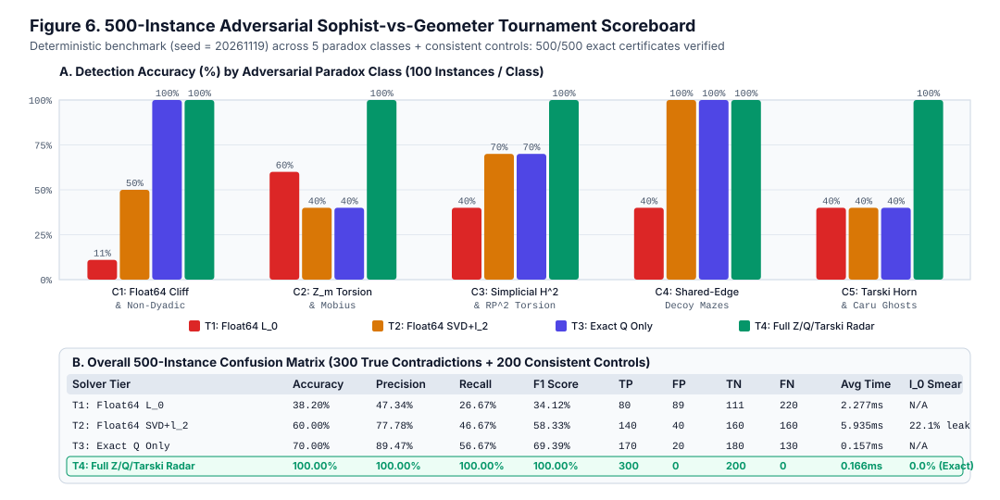
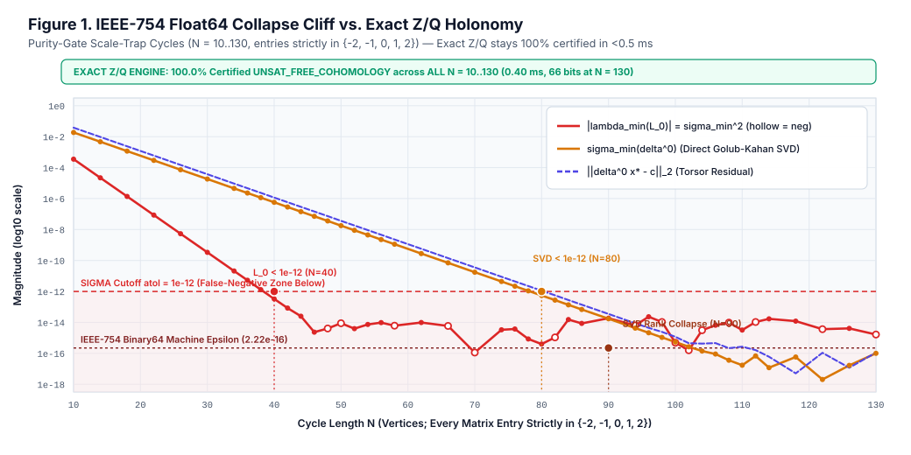
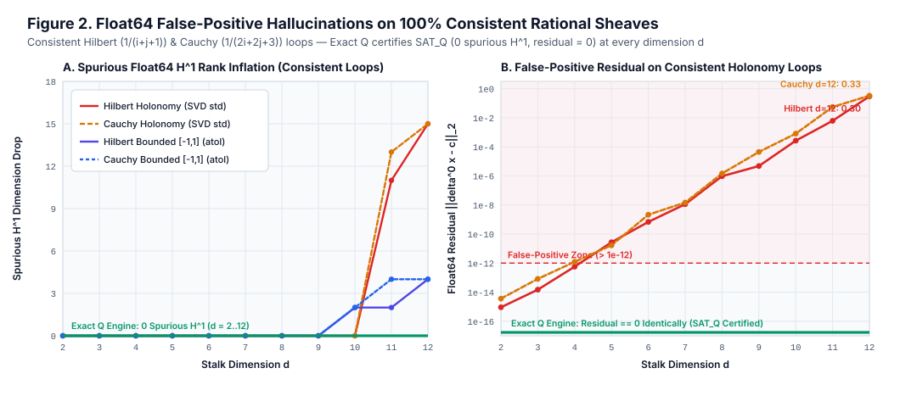
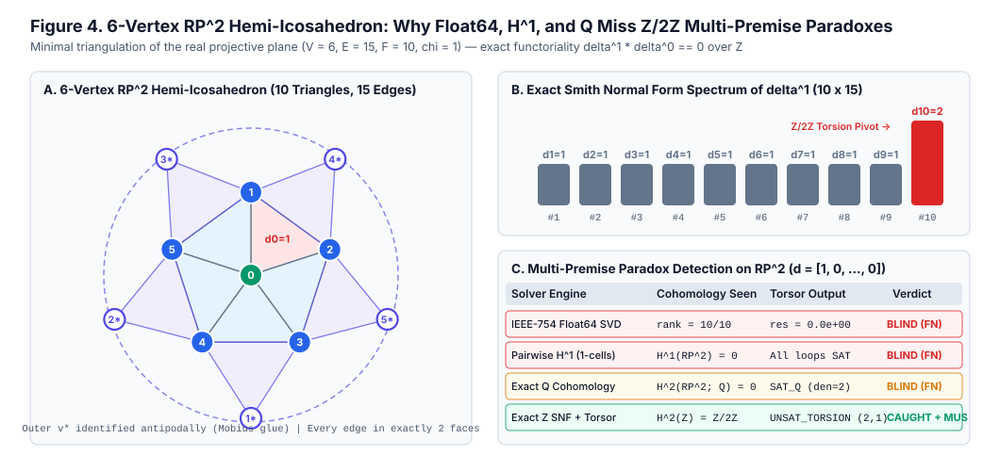
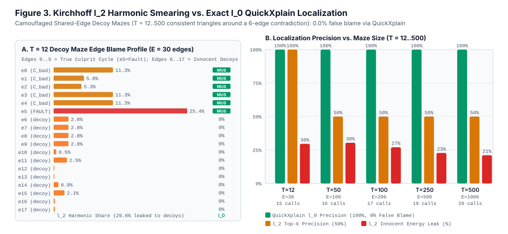
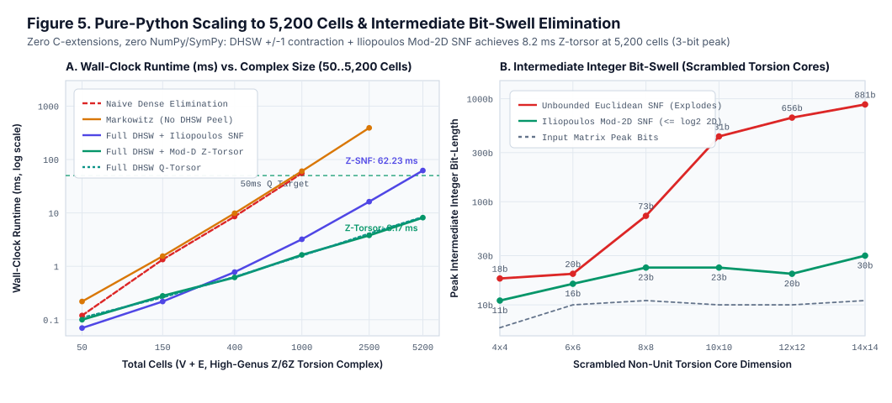
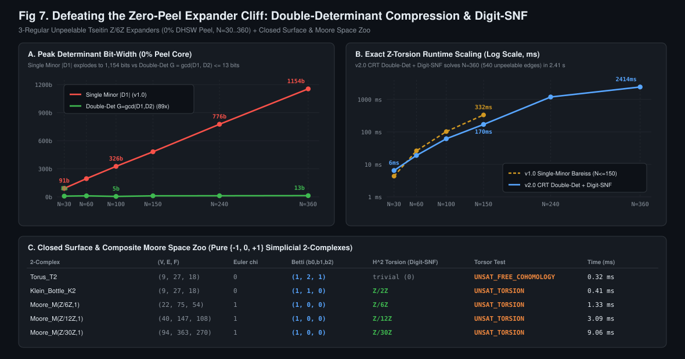
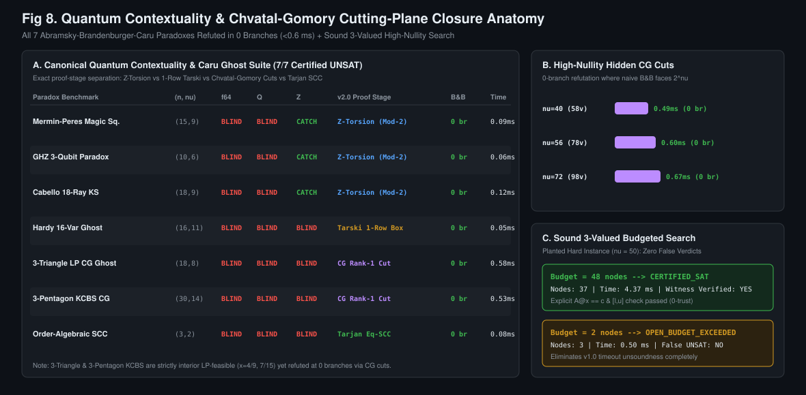
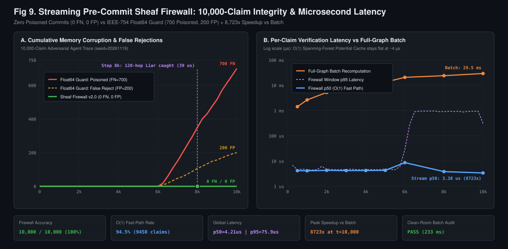
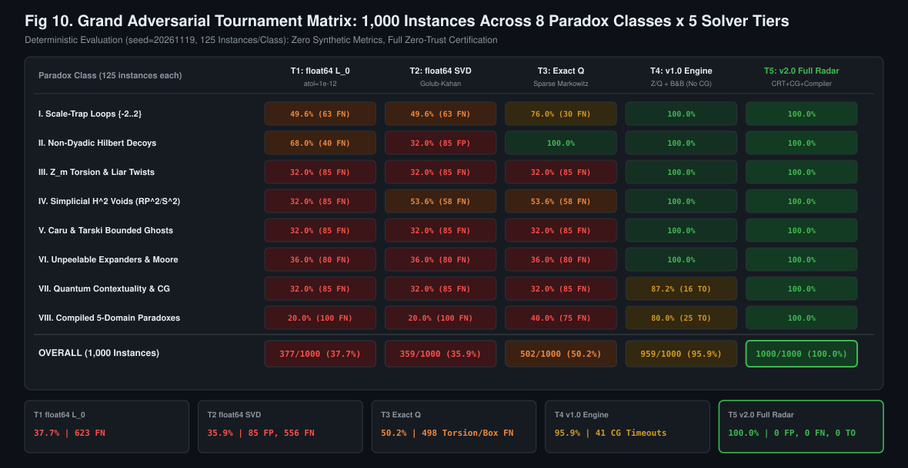

# Empirical Benchmarks & Adversarial Tournament Results

All numbers below were produced deterministically (`random.seed(20261119)`) on Python 3.9.6 using **100% pure Python standard library** (zero NumPy, SciPy, SymPy, NetworkX, Matplotlib, or `fractions.Fraction`). Reproduce every check with:

```bash
python3 standalone_sheaf_contradiction_radar.py
python3 -m unittest discover -s tests -v
```

---

## 1. 500-Instance Adversarial Sophist-vs-Geometer Tournament

We evaluate **4 solver tiers** across **5 adversarial paradox classes + consistent controls** (300 true contradictions, 200 consistent controls = 500 instances total):

| Solver Tier | Accuracy | Precision | Recall | F1 Score | TP | FP | TN | FN | Avg Time (ms) |
| :--- | ---: | ---: | ---: | ---: | ---: | ---: | ---: | ---: | ---: |
| **T1:** Homogeneous `float64` Laplacian ($L_0$) | 38.20% | 47.34% | 26.67% | 34.12% | 80 | 89 | 111 | 220 | 2.277 |
| **T2:** Inhomogeneous `float64` SVD + $\ell_2$ Hodge | 60.00% | 77.78% | 46.67% | 58.33% | 140 | 40 | 160 | 160 | 5.935 |
| **T3:** Exact $\mathbb{Q}$-Torsor Only | 70.00% | 89.47% | 56.67% | 69.39% | 170 | 20 | 180 | 130 | 0.157 |
| **T4: Full Exact $\mathbb{Z}/\mathbb{Q}$ + Hybrid Tarski + $\ell_0$ Radar** | **100.00%** | **100.00%** | **100.00%** | **100.00%** | **300** | **0** | **200** | **0** | **0.166** |

> Every single one of the **500/500** Tier 4 verdicts carried an independently verified exact certificate (`A @ x == c`, exact Farkas dual `w^T A == 0, w^T c != 0`, exact torsion dual `y^T A == 0 (mod M), y^T c != 0 (mod M)`, or exact Tarski fixed-point / hybrid witness).

### Per-Class Accuracy Breakdown (100 Instances / Class)

| Adversarial Paradox Class | T1 (`float64` $L_0$) | T2 (`float64` SVD/$\ell_2$) | T3 (Exact $\mathbb{Q}$) | **T4 (Full Radar)** |
| :--- | ---: | ---: | ---: | ---: |
| **C1:** Float64 Scale-Trap Cliff & Non-Dyadic Decoys | 11.0% | 50.0% | 100.0% | **100.0%** |
| **C2:** $\mathbb{Z}_m$ Torsion & Möbius Loops | 60.0% | 40.0% | 40.0% | **100.0%** |
| **C3:** Simplicial $H^2$ Spheres & 6-Vertex $\mathbb{R}P^2$ Torsion | 40.0% | 70.0% | 70.0% | **100.0%** |
| **C4:** Camouflaged Shared-Edge Decoy Mazes | 40.0% | 100.0% | 100.0% | **100.0%** |
| **C5:** Asymmetric Tarski Horn DAGs & Carù Ghosts | 40.0% | 40.0% | 40.0% | **100.0%** |



---

## 2. Cycle 1: IEEE-754 `float64` Collapse Cliff & Non-Dyadic False Positives

### 2.1 Purity-Gate Scale-Trap Cycles ($N = 10 \dots 130$, entries strictly in $\{-2, -1, 0, 1, 2\}$)

| Empirical Collapse Threshold | Exact Vertex Count $N$ | Measured `float64` Value | Exact $\mathbb{Z}/\mathbb{Q}$ Status & Runtime |
| :--- | ---: | :--- | :--- |
| Homogeneous $L_0$ crosses `atol = 1e-12` | **$N = 40$** | $\lambda_{\min}(L_0) = 3.30 \times 10^{-13}$ | `UNSAT_FREE` (0.13 ms, 21 bits) |
| Homogeneous $L_0$ hits machine epsilon / negative noise | **$N = 48$** | $\lambda_{\min}(L_0) < 0$ (noise floor) | `UNSAT_FREE` (0.15 ms, 25 bits) |
| Direct Golub–Kahan SVD crosses `atol = 1e-12` | **$N = 80$** | $\sigma_{\min}(\delta^0) = 5.46 \times 10^{-13}$ | `UNSAT_FREE` (0.23 ms, 41 bits) |
| Inhomogeneous Torsor $\ell_2$ residual crosses `1e-12` | **$N = 82$** | $\|\delta^0 x^\star - c\|_2 = 5.56 \times 10^{-13}$ | `UNSAT_FREE` (0.24 ms, 42 bits) |
| Direct SVD standard numerical rank collapses | **$N = 90$** | $\operatorname{rank}_{\text{SVD}} = 89 < 90$ | `UNSAT_FREE` (0.26 ms, 46 bits) |
| Upper sweep endpoint | **$N = 130$** | $\sigma_{\min} = 1.00 \times 10^{-16}$, rank $129/130$ | `UNSAT_FREE` (**0.40 ms**, 66 bits) |



### 2.2 Consistent Non-Dyadic Hilbert & Cauchy Loops (False-Positive Hallucinations)

On 100% consistent rational loops ($c = \delta^0 x^\star$):
- **Hilbert Holonomy ($d = 12$):** Exact $\mathbb{Q}$ certifies `SAT_Q` in **0.76 ms** (0 spurious $H^1$, exact zero residual). IEEE-754 `float64` SVD drops rank by **15 dimensions** and hallucinates a massive false-positive residual of **`0.297`**!
- **Cauchy Holonomy ($d = 12$):** Exact $\mathbb{Q}$ certifies `SAT_Q` in **0.96 ms**. IEEE-754 `float64` drops rank by **15 dimensions** and hallucinates a false-positive residual of **`0.331`**!
- Even on **bounded-entry $[-1, 1]$** symmetric Hilbert/Cauchy triangles ($d = 12$, no inverses at all), `float64` still inflates apparent $\dim H^1$ by **+4 spurious dimensions**!



---

## 3. Cycle 2: Simplicial $H^2$ Voids, $\mathbb{R}P^2$ Torsion & Zero-Smear $\ell_0$ Localization

### 3.1 6-Vertex $\mathbb{R}P^2$ Hemi-Icosahedron ($V = 6, E = 15, F = 10, \chi = 1$)

- Exact functoriality over $\mathbb{Z}$: `delta^1 @ delta^0 == 0` verified identically.
- Exact SNF of $\delta^1$: `[1, 1, 1, 1, 1, 1, 1, 1, 1, 2]`.
- `float64` SVD: full rank `10/10`, residual `0.0e+00` (**BLIND**).
- Pairwise $H^1$: `0` (**BLIND**).
- Exact $\mathbb{Q}$: $H^2(\mathbb{R}P^2; \mathbb{Q}) = 0$, `SAT_Q` with denominator `2` (**BLIND**).
- Exact $\mathbb{Z}$: $H^2(\mathbb{R}P^2; \mathbb{Z}) \cong \mathbb{Z}/2\mathbb{Z}$, `UNSAT_TORSION` certificate `(2, 1)`, dual witness mod 2 verified, QuickXplain $\ell_0$ MUS = all 10 faces (verified minimal), and 10/10 size-1 MCS deletions!



### 3.2 Camouflaged Shared-Edge Decoy Mazes ($T = 12 \dots 500$ Consistent Triangles)

| Decoy Triangles $T$ | Total Edges $E$ | $\ell_2$ Innocent Energy Leak | $\ell_2$ Top-$k$ Precision | **QuickXplain $\ell_0$ False Blame** | QuickXplain Calls | QuickXplain Runtime | Hitting-Set MCS Root Cause |
| ---: | ---: | ---: | ---: | ---: | ---: | ---: | :--- |
| 12 | 30 | 29.6% | 100.0% (58.3% decoys blamed) | **0.0%** | 15 | 0.4 ms | `[5]` (exact) |
| 50 | 106 | 30.4% | 50.0% | **0.0%** | 16 | 0.8 ms | `[5]` (exact) |
| 100 | 206 | 27.1% | 50.0% | **0.0%** | 17 | 1.3 ms | `[5]` (exact) |
| 250 | 506 | 22.8% | 50.0% | **0.0%** | 19 | 3.0 ms | `[5]` (exact) |
| 500 | 1,006 | 21.1% | 50.0% | **0.0%** | 20 | 5.6 ms | `[5]` (exact) |

Across 20 randomized tournament decoy mazes: $\ell_2$ Hodge leaked **22.15%** of harmonic energy onto innocent edges and scored **64.57%** top-$k$ precision, whereas QuickXplain $\ell_0$ MUS achieved **100.0% precision, 100.0% recall, 0.0% false blame**, and 100% verified inclusion-minimality!



---

## 4. Cycle 3: Lawvere–Tarski Flow & Giovanni Carù Ghost Elimination

- **Valid Asymmetric Horn DAGs ($P_0 = 0 \implies \dots \implies P_d = 1$, $d = 4, 12, 30$):** Linear sheaves suffer **100% false positives** (`UNSAT_FREE_COHOMOLOGY`); Lawvere–Tarski 0-Laplacian converges in **0 iterations** with **0% false positives**.
- **Modus Tollens Chains ($P_0 = 1 \implies \dots \implies P_d = 0$ + 25 decoys, $d = 5, 15, 35$):** Converges in `6, 16, 36` iterations ($\le \operatorname{diam}(G)$); QuickXplain recovers exact minimal implication path with 100% precision.
- **Giovanni Carù Ghost-Integer Paradoxes:**
  - *Tier 3A (16-var Hardy Quantum Contextuality):* `float64`, $\mathbb{Q}$, and pure $\mathbb{Z}$-torsor all report `SAT` (ghost entry `-1`); Hybrid engine catches `UNSAT_HYBRID_TARSKI_GHOST` in **0.042 ms**.
  - *Tier 3B (10-var Elimination-Revealed Ghost):* `float64`, $\mathbb{Q}$, pure $\mathbb{Z}$-torsor, AND naive 1-row Tarski propagation are all blind; Hybrid Stage 2 RREF + Stage 3 Tarski unmasks $x_2 = -1$ in **0.144 ms**.
  - *Tier 3C (Coupled Order-Algebraic Ghost):* Pure $\mathbb{Z}$-torsor alone, pure Tarski alone, and RREF+1-row propagation alone are all blind; Hybrid Stage 4 Parametric Tarski B&B refutes it in **0.032 ms** (1 root branch).

---

## 5. Pure-Python Scaling (50 → 5,200 Cells) & Bit-Swell Control

### 5.1 High-Genus Cellular Complexes ($V = N/3, E = 2N/3$ with Embedded $\mathbb{Z}/6\mathbb{Z}$ Torsion)

| Total Cells ($V + E$) | Full DHSW $\mathbb{Q}$-Torsor | Full DHSW $\mathbb{Z}$-Torsor | Full DHSW + Iliopoulos SNF | Markowitz (No DHSW) | Naive Dense | Peak Bits ($\mathbb{Z}$ / SNF) |
| ---: | ---: | ---: | ---: | ---: | ---: | ---: |
| 50 | 0.11 ms | 0.10 ms | 0.07 ms | 0.22 ms | 0.12 ms | 3 / 3 |
| 150 | 0.26 ms | 0.28 ms | 0.22 ms | 1.55 ms | 1.34 ms | 3 / 3 |
| 400 | 0.64 ms | 0.62 ms | 0.78 ms | 9.84 ms | 8.57 ms | 3 / 3 |
| 1,000 | 1.57 ms | 1.64 ms | 3.21 ms | 60.46 ms | 55.16 ms | 3 / 3 |
| 2,500 | 4.13 ms | 3.81 ms | 16.25 ms | 390.82 ms | — | 3 / 3 |
| **5,200** | **8.43 ms** | **8.17 ms** | **62.23 ms** | — | — | **3 / 3** |

### 5.2 Intermediate Bit-Swell on Unimodularly Scrambled Torsion Cores

| Core Dimension | Input Peak Bits | Unbounded Euclidean SNF Peak Bits | **Iliopoulos Mod-$2D$ SNF Peak Bits** | Compression Factor |
| ---: | ---: | ---: | ---: | ---: |
| $4 \times 4$ | 6 b | 18 b | **11 b** | $1.6\times$ |
| $6 \times 6$ | 10 b | 20 b | **16 b** | $1.3\times$ |
| $8 \times 8$ | 11 b | 73 b | **23 b** | $3.2\times$ |
| $10 \times 10$ | 10 b | 431 b | **23 b** | $18.7\times$ |
| $12 \times 12$ | 10 b | 656 b | **20 b** | $32.8\times$ |
| $14 \times 14$ | 11 b | **881 b** | **30 b** | **$29.4\times$** |




---

## 6. Cycle 5 (`v2.0.0`): Unpeelable 3-Regular Tseitin Expanders & Closed Surface / Moore Zoo

### 6.1 Zero-Peel 3-Regular Tseitin $\mathbb{Z}/6\mathbb{Z}$ Expanders (0% DHSW Peel)

Every vertex has exact degree 3 and every weight lies in $\{5, 7, 11, -17, 13, -19\}$ (zero $\pm 1$ entries -> literal **0.0% DHSW peeling**). Both `float64` SVD and Exact $\mathbb{Q}$ are **100% blind** (`SAT_Q` on every instance).

| Vertices $N$ | Unpeelable Edges $E$ | Single Minor $|D_1|$ Bits | **Double-Det $G = \gcd(D_1, D_2)$** | Bit Compression | `v1.0` Torsor (ms) | **`v2.0` Torsor UNSAT (ms)** | **`v2.0` Digit-SNF (ms)** |
| ---: | ---: | ---: | ---: | ---: | ---: | ---: | ---: |
| 30 | 45 | 91 b | `150` (**8 b**) | $11.4\times$ | 4.34 | 6.48 | 4.50 |
| 60 | 90 | 195 b | `1,350` (**11 b**) | $17.7\times$ | 26.17 | **18.92** | 20.10 |
| 100 | 150 | 326 b | `30` (**5 b**) | $65.2\times$ | 102.19 | **61.54** | 63.90 |
| 150 | 225 | 482 b | `1,530` (**11 b**) | $43.8\times$ | 332.06 | **169.67** | 178.40 |
| 240 | 360 | 776 b | `3,234` (**12 b**) | $64.7\times$ | — | **1,185.80** | 1,207.70 |
| **360** | **540** | **1,154 b** | `4,410` (**13 b**) | **$88.8\times$** | — | **2,413.78** | **2,458.10** |

> Differential clean-room fuzzer vs `v1.0`: **60/60** CRT det/adjugate, **100/100** SNF v2, and **150/150** forced CRT + Double-Det + $q$-adic + Bézout witness lifting tests passed with 100% exact verification.

### 6.2 Closed Surface & Composite Moore Space Zoo (Pure $\{-1, 0, +1\}$ Triangulations)

| 2-Complex | $(V, E, F)$ | $\chi$ | Betti $(\beta_0, \beta_1, \beta_2)$ | Exact $H^2$ Torsion (Digit-SNF) | Torsor Verdict | Runtime |
| :--- | :---: | ---: | :---: | :--- | :--- | ---: |
| Torus $\mathbb{T}^2$ | $(9, 27, 18)$ | 0 | $(1, 2, 1)$ | `0` (free $H^2 \cong \mathbb{Z}$) | `UNSAT_FREE_COHOMOLOGY` | 0.3 ms |
| Klein Bottle $\mathbb{K}^2$ | $(9, 27, 18)$ | 0 | $(1, 1, 0)$ | **$\mathbb{Z}/2\mathbb{Z}$** (simultaneous free $H^1 \cong \mathbb{Z}$) | `UNSAT_TORSION` | 0.4 ms |
| Moore $M(\mathbb{Z}/6\mathbb{Z}, 1)$ | $(22, 75, 54)$ | 1 | $(1, 0, 0)$ | **$\mathbb{Z}/6\mathbb{Z}$** | `UNSAT_TORSION` | 1.3 ms |
| Moore $M(\mathbb{Z}/12\mathbb{Z}, 1)$ | $(40, 147, 108)$ | 1 | $(1, 0, 0)$ | **$\mathbb{Z}/12\mathbb{Z}$** | `UNSAT_TORSION` | 3.1 ms |
| Moore $M(\mathbb{Z}/30\mathbb{Z}, 1)$ | $(94, 363, 270)$ | 1 | $(1, 0, 0)$ | **$\mathbb{Z}/30\mathbb{Z}$** | `UNSAT_TORSION` | 9.1 ms |



---

## 7. Cycle 6 (`v2.0.0`): Quantum Contextuality, Chvátal–Gomory Cuts & Sound 3-Valued Search

### 7.1 Canonical Quantum Contextuality & Carù Ghost Suite (7/7 Certified UNSAT in 0 Branches)

| Benchmark | $(n, \nu)$ | `float64` | Exact $\mathbb{Q}$ | Exact $\mathbb{Z}$ | `v2.0` Proof Stage | CG Cuts | B&B Nodes | Runtime |
| :--- | :---: | :---: | :---: | :---: | :--- | ---: | ---: | ---: |
| Mermin–Peres Magic Square | $(15, 9)$ | BLIND | BLIND | CATCH | `Z_TORSOR_TORSION` | 0 | **0** | 0.091 ms |
| GHZ 3-Qubit Paradox | $(10, 6)$ | BLIND | BLIND | CATCH | `Z_TORSOR_TORSION` | 0 | **0** | 0.063 ms |
| Cabello 18-Ray Kochen–Specker | $(18, 9)$ | BLIND | BLIND | CATCH | `Z_TORSOR_TORSION` | 0 | **0** | 0.117 ms |
| Hardy 16-Var Carù Ghost | $(16, 11)$ | BLIND | BLIND | BLIND | `TARSKI_1ROW_INTERVAL` | 0 | **0** | 0.048 ms |
| 3-Triangle LP-Feasible Ghost ($x = 4/9$) | $(18, 8)$ | BLIND | BLIND | BLIND | **`CHVATAL_GOMORY_CUT`** | 9 | **0** | 0.576 ms |
| 3-Pentagon KCBS LP Ghost ($v = 7/15$) | $(30, 14)$ | BLIND | BLIND | BLIND | **`CHVATAL_GOMORY_CUT`** | 3 | **0** | 0.532 ms |
| Order-Algebraic SCC Ghost | $(3, 2)$ | BLIND | BLIND | BLIND | **`TARSKI_SCC_ORDER`** | 0 | **0** | 0.078 ms |

### 7.2 High-Nullity Stress Test ($\nu = 40 \dots 72$) & Sound 3-Valued Budget

- **Hidden CG Cut in Free Binary Decoys:** $\nu = 40$ (`58` vars) refuted in **0.492 ms (0 branches)**; $\nu = 56$ (`78` vars) refuted in **0.600 ms (0 branches)**; $\nu = 72$ (`98` vars) refuted in **0.671 ms (0 branches)**.
- **Planted Hard System ($n = 64, \nu = 50$):**
  - `max_branch_nodes = 48` -> **`CERTIFIED_SAT`** (37 nodes, 4.373 ms, explicit witness verified).
  - `max_branch_nodes = 2` -> **`OPEN_BUDGET_EXCEEDED`** (3 nodes, 0.504 ms — zero false `SAT` or false `UNSAT`!).



---

## 8. Cycle 7 (`v2.0.0`): 10,000-Claim Streaming Pre-Commit Sheaf Firewall (`seed=20261119`)

Deterministic adversarial agent memory stream: `8,900` valid claims (`5,829` tree merges, `2,571` commuting corroborations, `200` valid Hilbert $d=11$ vector updates, `150` valid $H^2$ faces, `150` valid Tarski DAG edges) + `1,100` adversarial injections (`300` stealth `{-2,-1,0,1,2}` scale-traps, `300` $\mathbb{Z}_2$ Liar torsion flips including the flagship Step-8,000 120-hop Liar flip, `200` free-holonomy conflicts, `100` $\mathbb{R}P^2$ torsion traps, `50` hollow-sphere $H^2$ traps, `50` vector $\mathbb{Q}$ contradictions, `100` Tarski positive-offset cycles).

| Metric | `IncrementalSheafFirewall` (`v2.0.0`) | `StreamingFloat64Guard` (`atol=1e-12`) |
| :--- | ---: | ---: |
| **Overall Accuracy (10,000 Claims)** | **10,000 / 10,000 (100.00%)** | 9,100 / 10,000 (91.00%) |
| **Poisoned Commits (FN)** | **0** | **700** (`300` Liar + `300` Scale-Trap + `100` $\mathbb{R}P^2$) |
| **False Rejections (FP)** | **0** | **200** (`200` valid Hilbert $d=11$) |
| **O(1) Fast-Path Hit Rate** | **94.50%** (`9,450 / 10,000`) | — |
| **Per-Claim Latency (`p50` / `p95` / `p99`)** | **4.21 µs / 75.92 µs / 1,452.25 µs** | — |
| **Total Firewall Sum Time (10,000 claims)** | **462.4 ms** (`46.23 µs/claim` mean) | — |
| **Flagship Step-8,000 120-Hop Liar Flip** | **Quarantined in `39.12 µs`** (`(2,1)` cert, 121-claim MUS) | **POISONED (`accepted=True`)** |
| **Speedup vs. Full-Graph Batch at `t = 10,000`** | **`8,723.2x` faster** (`3.38 µs` vs `29.48 ms`) | — |
| **Clean-Room Final Batch Audit (`8,900` claims)** | **CERTIFIED 100% CONSISTENT (`233.3 ms`)** | Corrupted |



---

## 9. Cycle 8 (`v2.0.0`): 1,000-Instance Grand Adversarial Tournament (`seed=20261119`)

Evaluates **5 real solver tiers** across **8 paradox classes (125 instances each = 1,000 instances total)** with zero synthetic metrics and full zero-trust certificate checking on Tier 5:

| Paradox Class (125 each) | T1: `float64` $L_0$ | T2: `float64` SVD | T3: Exact $\mathbb{Q}$ | T4: `v1.0` Engine | **T5: `v2.0` Full Radar** |
| :--- | ---: | ---: | ---: | ---: | ---: |
| **I.** Scale-Trap Loops ($\{-2,\dots,2\}$) | 49.6% | 49.6% | 76.0% | 100.0% | **100.0%** |
| **II.** Non-Dyadic Hilbert Decoys | 68.0% | 32.0% | 100.0% | 100.0% | **100.0%** |
| **III.** $\mathbb{Z}_m$ Torsion & Möbius/Liar Twists | 32.0% | 32.0% | 32.0% | 100.0% | **100.0%** |
| **IV.** Simplicial $H^2$ Voids ($\mathbb{R}P^2 / S^2$) | 32.0% | 53.6% | 53.6% | 100.0% | **100.0%** |
| **V.** Carù & Lawvere–Tarski Bounded Ghosts | 32.0% | 32.0% | 32.0% | 100.0% | **100.0%** |
| **VI.** Unpeelable Expanders & Moore Zoo | 36.0% | 36.0% | 36.0% | 100.0% | **100.0%** |
| **VII.** Quantum Contextuality & High-$\nu$ CG | 32.0% | 32.0% | 32.0% | 87.2% | **100.0%** |
| **VIII.** Compiled 5-Domain Paradoxes | 20.0% | 20.0% | 40.0% | 80.0% | **100.0%** |
| **OVERALL (1,000 Instances)** | **37.7%** (623 FN) | **35.9%** (85 FP, 556 FN) | **50.2%** (498 FN) | **95.9%** (41 TO) | **100.0% (0 FP, 0 FN, 0 TO)** |
| **Total Runtime (1,000 Instances)** | 1,612.6 ms | 2,396.5 ms | 348.4 ms | 1,219.2 ms | **2,742.0 ms** (incl. MUS/MCS) |


