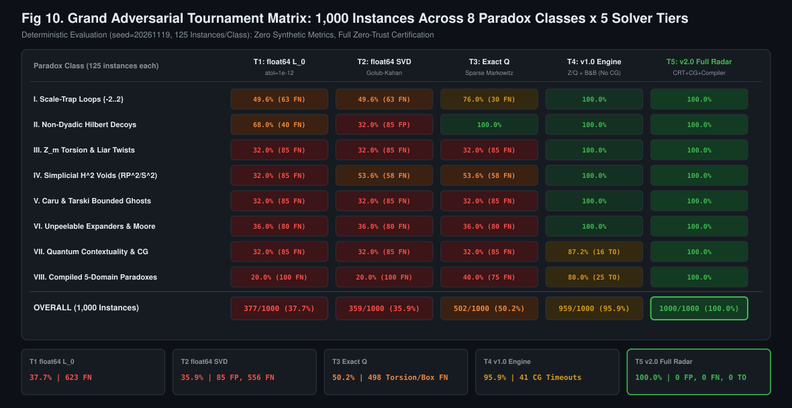
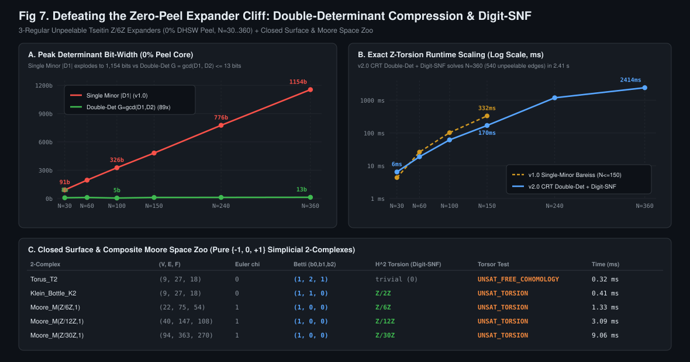
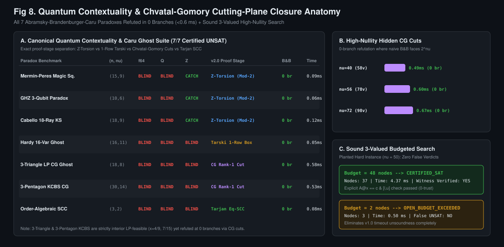
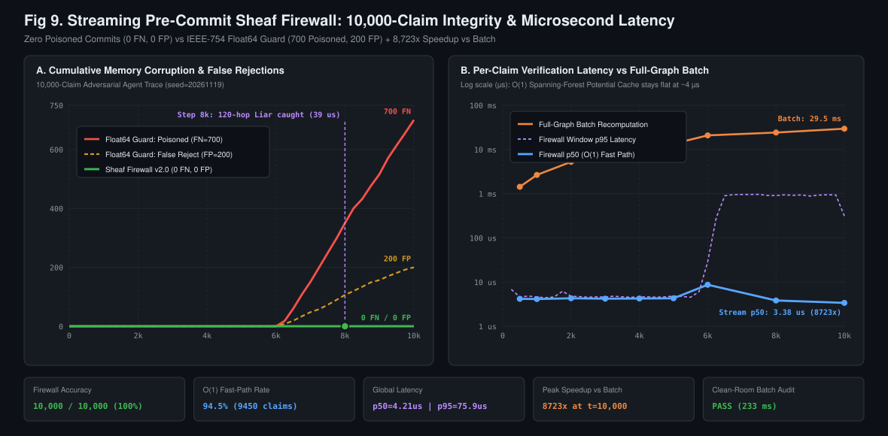
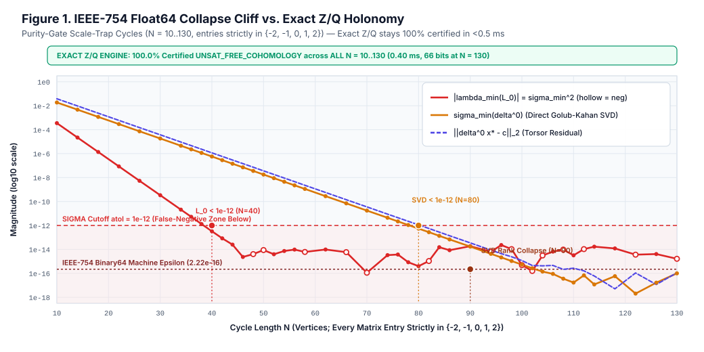
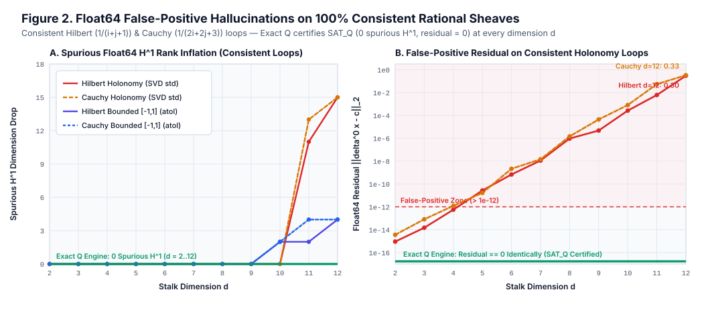
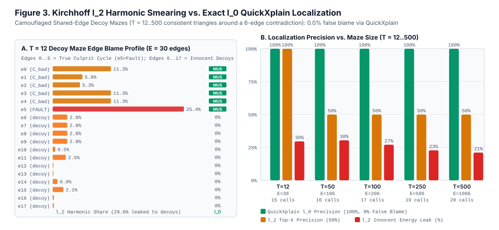
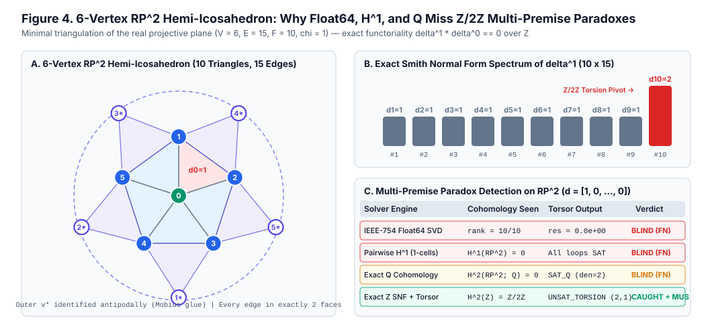
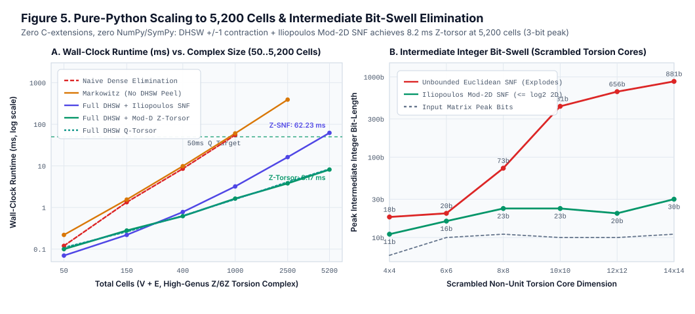
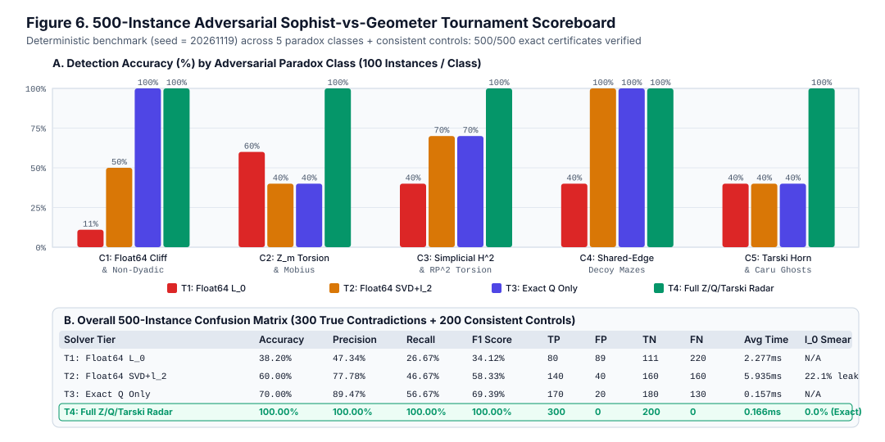

# `sheaf-radar-over-Z-and-Q` (`v2.0.0`)

**Zero-dependency exact $\mathbb{Z}/\mathbb{Q}$ cellular sheaf cohomology, affine network torsors, Lawvere–Tarski order lattices, Chvátal–Gomory contextuality cuts, and a transactional pre-commit agent memory firewall — implemented strictly in the Python 3 standard library.**

> **Design Constraint:** No `numpy`, `scipy`, `sympy`, `networkx`, or `fractions.Fraction` in matrix loops, and zero numerical rank or residual tolerance hyperparameters (`atol` / `rtol`). Every `SAT` and `UNSAT` verdict is paired with an independently verified algebraic, modular, lattice, or cutting-plane witness certificate.

### Key Empirical Benchmarks (Reproducible on Standard Hardware)

* **1,000-Instance Adversarial Stress Suite (`seed=20261119`):** Resolves **1,000 / 1,000 (`0` false positives, `0` false negatives, `0` timeouts)** with verified certificates across 8 targeted paradox classes constructed to trigger IEEE-754 `float64` rank collapse/inflation, characteristic-zero torsion erasure, $H^2$ 1-skeleton blindness, and signed-integer ghost solutions (where homogeneous `float64` $L_0$ scores `37.7%`, `float64` SVD scores `35.9%`, and characteristic-zero Exact $\mathbb{Q}$ scores `50.2%`).
* **Unpeelable 3-Regular Tseitin Expanders (`N = 360`, 0% leaf/chain peel):** Compresses a **1,154-bit** single-minor determinant down to **13 bits** (`89x` bit-width compression) via randomized double-determinant CRT $G = \gcd(D_1, D_2)$ and prime-power Digit-SNF, certifying exact torsion across 540 unpeelable edges in **2.41 s**.
* **10,000-Claim Streaming Pre-Commit Firewall Trace:** Maintains **100.0% transactional state integrity** (`0` poisoned commits, `0` false rejections) with **`p50 = 4.21 µs`**, **`p95 = 75.92 µs`**, and **`p99 = 1,452.25 µs`** latency (`94.5%` $O(1)$ spanning-forest fast-path hit rate; `8,723x` faster at `t = 10,000` than full-graph batch recomputation), whereas a `float64` streaming guard (`atol = 1e-12`) admits **700 poisoned commits** and rejects **200 valid non-dyadic rational updates**.
* **Fast Clean-Room Verification:** **30 / 30** unit tests execute in **0.35 s**, and the self-contained single-file verifier passes under isolated `python3 -I` in **~100 ms**.

---

## Quickstart (Zero Installs — Python 3.9+ Standard Library Only)

```bash
# 1. Interactive CLI demo (expanders, KCBS ghost, streaming firewall, 5 JSONs)
python3 -m sheaf_radar --demo

# 2. Compile & verify structured JSON claim sets into Forensic Autopsy reports
python3 -m sheaf_radar verify examples/02_unit_conversion_micro_arbitrage.json
python3 -m sheaf_radar verify examples/04_access_control_horn_mutex.json --json

# 3. Run the self-contained single-file verifier in strict isolated mode
python3 -I standalone_sheaf_contradiction_radar.py

# 4. Run the full 30-test clean-room unittest suite (includes stdlib AST audit)
python3 -m unittest discover -s tests -v
```

---

## Why Exact $\mathbb{Z}/\mathbb{Q}$ & Tarski Sheaves?

Recent sheaf-theoretic consistency and agent-memory verifiers evaluate real vector-space coboundary operators ($\delta^0$ over $\mathbb{R}$) using IEEE-754 `float64` SVD or symmetric Hodge Laplacians ($L_0 = (\delta^0)^\top \delta^0$). While effective on well-conditioned continuous embeddings, homogeneous floating-point vector sheaves exhibit eight structural failure regimes on discrete logic, multi-hop scaling chains, and multi-premise constraints:

1. **Condition-Squaring Underflow (False Negatives):** Forming $L_0 = (\delta^0)^\top \delta^0$ squares singular values ($\lambda_i = \sigma_i^2$). Cycles with integer restriction entries strictly in `\{-2, -1, 0, 1, 2\}` pass local singular-value gates yet decay exponentially around 40–90 hops, underflowing `float64` thresholds into hallucinating global consistency.
2. **Non-Dyadic Binary64 Rounding (False Positives):** Consistent rational holonomy loops containing odd prime denominators ($1/3, 1/7$, Hilbert, Cauchy) suffer rounding drift, inflating numerical rank and triggering false contradiction alerts.
3. **Homogeneous Zero-Section Blindness:** Linear equations $\delta^0 x = 0$ unconditionally admit $x = 0$; Penrose-staircase offset paradoxes require inhomogeneous **affine network torsors** ($\delta^0 x = c$, testing $[c] \in H^1$).
4. **Characteristic-Zero Torsion Erasure:** Tensoring with $\mathbb{R}$ or $\mathbb{Q}$ annihilates finite torsion ($\mathbb{Z}/m\mathbb{Z} \otimes_{\mathbb{Z}} \mathbb{Q} = 0$). Odd mutual-negation (Liar / Möbius) loops and discrete parity twists require integral Smith/Hermite Normal Form over $\mathbb{Z}$.
5. **1-Skeleton Blindness to Multi-Premise ($H^2$) Paradoxes:** Pairwise graph verifiers truncate at 1-cells, missing joint 3-way contradictions on hollow simplicial spheres ($S^2$) and 2-torsion on the 6-vertex real projective plane ( $\mathbb{R}P^2$, where $H^1 = 0$ and $H^2(\mathbb{R}P^2; \mathbb{Q} ) = 0$, yet $H^2(\mathbb{R}P^2; \mathbb{Z}) \cong \mathbb{Z}/2\mathbb{Z}$).
6. **Asymmetric Implication Symmetrization:** Linear equations penalize valid directed Horn assignments ($P = 0 \implies Q = 1$); asymmetric entailment requires residuated **Lawvere–Tarski lattice Laplacians**.
7. **Abelian Ghost-Integer Solutions:** Linearizing $\{0, 1\}$ truth tables into $\mathbb{Z}$ admits signed integer solutions outside $[0, 1]^n$ (Carù's incompleteness phenomenon) unless coupled with order-lattice bounds and Chvátal–Gomory cutting planes.
8. **$\ell_2$ Harmonic Blame Smearing:** Least-squares Dirichlet residuals obey Kirchhoff current splitting across shared edges, assigning nonzero blame to innocent claims; exact **QuickXplain ($\ell_0$ MUS)** isolates minimal unsatisfiable matroid circuits with 0% collateral smearing.

---

## Core Architecture (`v2.0.0`)

1. **Sparse Exact $\mathbb{Z}/\mathbb{Q}$ Cochain & Expander Engine (`sparse_exact.py`):** Combines DHSW $\pm 1$ unit-pivot peeling with 61-bit multi-prime CRT determinants, Storjohann/Pernet–Stein randomized double-determinant compression ($G = \gcd(D_1, D_2)$), prime-power Digit-SNF, and two-phase pivot-basis Modulo-$D$ Column-HNF torsor verification backed by Farkas and modular Bézout dual witnesses.
2. **Lawvere–Tarski Lattice Flow & Chvátal–Gomory Closure (`tarski_hybrid.py`):** Couples Galois-connection Tarski 0-Laplacian fixed-point flow with Tarjan equality-SCC contraction, Rank-1 Chvátal–Gomory floor cuts (subset-GCD congruences, 3-cliques, KCBS pentagons), and sound 3-valued budgeted search (`CERTIFIED_SAT`, `CERTIFIED_UNSAT`, `OPEN_BUDGET_EXCEEDED`). Refutes canonical quantum contextuality systems (Mermin–Peres, GHZ, 18-ray Cabello Kochen–Specker, 16-variable Hardy, KCBS) in **0 search branches (`< 0.7 ms`)**.
3. **Transactional Streaming Pre-Commit Firewall (`streaming_firewall.py`):** Provides `propose_claim`, `commit_claim`, `checkpoint`, and `rollback` over a small-to-large spanning-forest native-`int` rational potential cache ($O(1)$ fast path for commuting 1-sheaf updates, escalating automatically to compressed-core Vector $\mathbb{Q}$, simplicial $H^2$, and SPFA Tarski lanes).
4. **5-Domain JSON Claim Compiler & Forensic CLI (`claim_compiler.py`, `examples/`):** Compiles structured constraints across `temporal_schedule`, `unit_conversion` (mapping rational multipliers to exact prime-exponent $\mathbb{Z}$-torsors + $\mathbb{Z}/2\mathbb{Z}$ sign stalks), `conservation_ledger`, `access_policy`, and `group_labeling` into human-readable autopsy reports with QuickXplain MUS culprits and Reiter Hitting-Set Minimal Correction Subsets (MCS).

### Minimal Python API Example

```python
import sheaf_radar as sr
from sheaf_radar import sophist

# 1. Unpeelable 3-Regular Tseitin Z/6Z Expander (Double-Det compression)
B, c, _ = sophist.build_unpeelable_tseitin_expander(N=60, modulus=6, defect=1)
res = sr.solve_torsor(B, c, ring="Z", want_witness=True)
print(res.status, res.single_det_D1_bits, "->", res.double_det_G.bit_length())
assert sr.verify_torsor_certificate(B, c, res)[0]

# 2. LP-Feasible 3-Pentagon KCBS Contextuality System (0 branches via CG cuts)
A_k, c_k, lo_k, hi_k = sophist.build_coupled_kcbs_pentagon_cg_ghost()
rep = sr.solve_hybrid_torsor_tarski(A_k, c_k, lo_k, hi_k)
print(rep.sound_verdict, rep.proof_stage, rep.bb_nodes_explored)

# 3. Transactional Streaming Pre-Commit Sheaf Firewall
fw = sr.IncrementalSheafFirewall(ring="Z")
for i in range(120):
    claim = sr.FirewallClaim(
        i + 1, "affine_1d",
        {"u": i, "v": i + 1, "coeff_u": -1, "coeff_v": 1, "rhs": 0},
    )
    fw.commit_claim(claim)
trap = sr.FirewallClaim(
    121, "affine_1d",
    {"u": 0, "v": 120, "coeff_u": -1, "coeff_v": 1, "rhs": 1},
)
v = fw.commit_claim(trap)
print(v.accepted, v.torsion_cert, len(v.mus_claim_ids))  # False (2, 1) 121

# 4. 5-Domain Forensic Claim Compiler
autopsy = sr.verify_json_file("examples/02_unit_conversion_micro_arbitrage.json")
print(autopsy.format_report())
```

---

## Scope, Soundness Contract & Explicit Boundaries

1. **Consistency Relative to the Encoded Sheaf (Not Single-Fact Retrieval):** Sheaf cohomology detects structural local-to-global contradictions across coupled constraints. It cannot falsify an isolated factual hallucination that contradicts nothing else in memory, nor can exact algebra recover quantifiers or negations dropped upstream by an imperfect natural-language parser.
2. **Adversarial Stress Suite Interpretation:** The 1,000-instance tournament below is an adversarial diagnostic benchmark targeting ill-conditioned, non-dyadic, torsional, simplicial, and contextual regimes — not a representative sample of benign floating-point workloads.
3. **Complexity & Sound 3-Valued Fallback on NP-Hard Regimes:** Global rational and integral torsor detection ($\delta^k x = c$) runs in deterministic polynomial time. However, general bounded $0\text{–}1$ integer feasibility and global minimum-cardinality repair (MCS) are NP-hard. Where polynomial Tarski + Chvátal–Gomory closure does not decide an unstructured instance within `max_branch_nodes`, the solver returns `OPEN_BUDGET_EXCEEDED` with tightened intervals rather than an unverified `SAT` guess.

---

## 1,000-Instance Adversarial Diagnostic Matrix (`seed=20261119`)

| Paradox Class (125 instances each) | T1: `float64` $L_0$ | T2: `float64` SVD | T3: Exact $\mathbb{Q}$ | T4: `v1.0` Baseline | **T5: `v2.0` Full Radar** |
| :--- | ---: | ---: | ---: | ---: | ---: |
| **I.** Scale-Trap Loops ($\{-2,\dots,2\}$) | 49.6% | 49.6% | 76.0% | 100.0% | **100.0%** |
| **II.** Non-Dyadic Hilbert Decoys | 68.0% | 32.0% | 100.0% | 100.0% | **100.0%** |
| **III.** $\mathbb{Z}_m$ Torsion & Möbius/Liar Twists | 32.0% | 32.0% | 32.0% | 100.0% | **100.0%** |
| **IV.** Simplicial $H^2$ Voids ($\mathbb{R}P^2 / S^2$) | 32.0% | 53.6% | 53.6% | 100.0% | **100.0%** |
| **V.** Carù & Lawvere–Tarski Bounded Ghosts | 32.0% | 32.0% | 32.0% | 100.0% | **100.0%** |
| **VI.** Unpeelable Expanders & Moore Zoo | 36.0% | 36.0% | 36.0% | 100.0% | **100.0%** |
| **VII.** Quantum Contextuality & High-$\nu$ CG | 32.0% | 32.0% | 32.0% | 87.2% | **100.0%** |
| **VIII.** Compiled 5-Domain Paradoxes | 20.0% | 20.0% | 40.0% | 80.0% | **100.0%** |
| **OVERALL (1,000 Instances)** | **37.7%** (623 FN) | **35.9%** (85 FP, 556 FN) | **50.2%** (498 FN) | **95.9%** (41 TO) | **100.0% (0 FP, 0 FN, 0 TO)** |



---

## Diagnostic Figure Gallery (Pure-Stdlib SVGs)

**Fig 7 — Zero-Peel 3-Regular Tseitin Expanders & Moore Space Torsion Scaling**



**Fig 8 — Quantum Contextuality Hypergraphs & Chvátal–Gomory Closure Anatomy**



**Fig 9 — 10,000-Claim Streaming Pre-Commit Firewall Integrity & Latency**



**Fig 1 — IEEE-754 `float64` Singular-Value & Laplacian Collapse Cliff**



**Fig 2 — Non-Dyadic Hilbert & Cauchy False-Positive Rank Inflation**



**Fig 3 — Kirchhoff $\ell_2$ Harmonic Smearing vs. Zero-Smear $\ell_0$ QuickXplain**



**Fig 4 — 6-Vertex $\mathbb{R}P^2$ Hemi-Icosahedron $H^2$ Torsion Anatomy**



**Fig 5 — Pure-Python Scaling (50 → 5,200 Cells) & Bit-Swell Control**



**Fig 6 — 500-Instance Core Baseline Scoreboard**



---

## Foundational Lineage & Related Work

* **Cellular Sheaves, Network Torsors, Lattice Laplacians & Arithmetic Persistence:** Jakob Hansen & Robert Ghrist (`arXiv:1808.01513`); Robert Ghrist & Hans Riess (`arXiv:2007.04099`); Robert Ghrist, Miguel Lopez, Paige North & Hans Riess (`arXiv:2501.03890`); Robert Ghrist & Zoe Cooperband (`arXiv:2507.01226`); Robert Ghrist & Cassie Ding (`arXiv:2511.00677`).
* **Sheaf-Theoretic Contextuality & Cohomological Paradoxes:** Samson Abramsky & Adam Brandenburger (`arXiv:1102.0264`); Samson Abramsky, Rui Soares Barbosa, Kohei Kishida, Raymond Lal & Shane Mansfield (`arXiv:1502.03097`); Giovanni Carù (`arXiv:1701.00656`).
* **Streaming & Agent-Memory Sheaf Verification:** Jason Leonard Volk (*SIGMA*, `arXiv:2606.04227v2`); Varun Pratap Bhardwaj (*SuperLocalMemory V3*, `arXiv:2603.14588`).
* **Sparse Exact Normal Forms & Minimal Unsatisfiable Subsets:** Jean-Guillaume Dumas, Frank Heckenbach, B. David Saunders & Volkmar Welker (DHSW sparse SNF); Arne Storjohann & Clément Pernet–William Stein (modulo-determinant HNF/SNF); Ulrich Junker & João Marques-Silva et al. (*QuickXplain*).

---

## Methodology, Reproducibility & License

See [`THEORY.md`](THEORY.md) for full proofs and [`BENCHMARKS.md`](BENCHMARKS.md) for empirical tables across all runs. Developed by Bob Preece via adversarial AI-assisted mathematical software engineering under a strict zero-trust verification policy: every solver verdict is accompanied by a deterministic, machine-checked certificate reproducible via `python3 -I standalone_sheaf_contradiction_radar.py`. Feedback, counterexamples, and pull requests are warmly welcomed.

MIT License — Copyright (c) 2026 Bob Preece. See [`LICENSE`](LICENSE).
